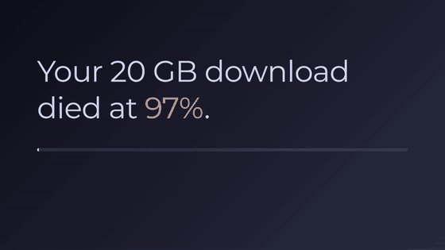

<div align="center">

<picture>
  <source media="(prefers-color-scheme: dark)" srcset="https://raw.githubusercontent.com/whoisjayd/blazeserve/main/docs/assets/logo-mark.svg" />
  
</picture>

# BlazeServe

**Share and move large files from your terminal.**<br />
One program for Linux, Windows and macOS: a file server, and downloads and uploads that resume.

[](https://github.com/whoisjayd/blazeserve/actions/workflows/ci.yml)
[](https://github.com/whoisjayd/blazeserve/releases)
[](https://crates.io/crates/blazeserve)
[](https://pypi.org/project/blazeserve/)
[](https://github.com/whoisjayd/blazeserve/pkgs/container/blazeserve)
[](LICENSE)

<a href="#install">Install</a> · <a href="#share">Share</a> · <a href="#download">Download</a> · <a href="#upload-and-check">Upload</a> · <a href="#background-jobs">Jobs</a> · <a href="#all-commands">Commands</a> · <a href="#documentation">Docs</a>

<br />



[Watch the full video](https://github.com/whoisjayd/blazeserve/blob/main/docs/assets/demo.mp4) (88 seconds, MP4)

</div>

## Install

**Linux and macOS**

```bash
curl -fsSL https://raw.githubusercontent.com/whoisjayd/blazeserve/main/install.sh | sh
```

**Windows (PowerShell)**

```powershell
irm https://raw.githubusercontent.com/whoisjayd/blazeserve/main/install.ps1 | iex
```

**Cargo**

```bash
cargo binstall blazeserve    # prebuilt program
cargo install blazeserve     # or build it: Rust 1.93 and a C compiler
```

<details>
<summary>pip, Docker and plain archives</summary>

| Method | Command |
| :--- | :--- |
| pip or uv | `pip install blazeserve` or `uv tool install blazeserve` |
| Docker | `docker run --rm -p 5949:5949 -v "$PWD":/data:ro ghcr.io/whoisjayd/blazeserve:latest` |
| Archive | The [Releases page](https://github.com/whoisjayd/blazeserve/releases), with the man page and shell completions; check it against `SHA256SUMS` |

</details>

The install scripts check the download against the published checksums. Builds exist for Linux (x86_64 and aarch64, glibc or static musl), Windows x86_64 and macOS (Intel and Apple silicon). Run `blaze upgrade` to update later.

This page describes the `main` branch; the newest release may not have every feature yet. See [upgrading](https://github.com/whoisjayd/blazeserve/blob/main/docs/upgrading.md).

## Start

Run `blaze` on its own and pick what you want to do. It asks the questions, runs the command and shows you what it ran.

## Share

```bash
blaze serve ./site                     # a folder, with listing, search and ZIP download
blaze send ./big.iso --qr              # one file; scan the code with a phone
blaze send ./big.iso --expires-after 20m
blaze serve ./inbox --uploads          # receive files
```

`--uploads` makes a password if you gave none, and prints the exact command and address to hand to the other person.

- If the default port 5949 is busy and you gave no `--port`, the next free one is used.
- Visitors cannot leave the shared folder, `--hide` keeps files invisible, and a missing password variable stops the server instead of leaving it open.
- While it runs, a live panel shows speed, requests, connections, bytes and errors.
- HTTPS, HTTP/2, ranges, caching, precompressed files, speed limits and trusted proxies are built in.

## Download

```bash
blaze info http://host:5949/big.iso                      # name, size, resume support first
blaze get http://host:5949/big.iso                       # resumes if interrupted
blaze get http://host:5949/big.iso -c 8                  # up to 8 connections
blaze get http://host:5949/big.iso --dry-run             # size, resume support, space, plan
blaze get http://host:5949/big.iso --verify server-sha256
blaze get http://host:5949/game.zip --extract --nested   # unpack, inner archives too
```

Large files arrive in parts over several connections. A live panel shows speed, time left and a block map of which parts are done, arriving and waiting.

- It uses fewer connections when the server refuses them, and more again when things recover.
- A full disk is reported before a byte is written.
- A partial or mismatched file never takes the final name.
- `--extract` consumes the archive as it unpacks, so you need about the extracted size free, not both.

## Upload and check

```bash
blaze put ./big.iso http://host:5949/ --auth-env BLAZE_AUTH
blaze checksum big.iso > SHA256SUMS
blaze verify --check SHA256SUMS       # also: .sha256 files and --sfv lists
```

Uploads resume, are sent in checked pieces, never overwrite without `--if-match`, and are compared with the SHA-256 the server stored. The folder page in the browser also has a drop box.

Keep passwords out of your shell history:

```bash
export BLAZE_AUTH='alice:s3cret'          # PowerShell: $env:BLAZE_AUTH = "alice:s3cret"
blaze serve ./site --auth-env BLAZE_AUTH
```

## Background jobs

Add `--background` to `serve`, `get` or `put`. Jobs keep running after the terminal closes.

```bash
blaze get http://host:5949/big.iso --background --name nightly
blaze status                # what is running
blaze status --all          # finished jobs too
blaze status --watch        # live dashboard of every job and its log; d deletes finished ones
blaze attach nightly        # one job in the foreground (also: blaze fg)
blaze stop                  # pick a job to stop
```

Stopping keeps a transfer's progress, so the same command resumes it.

## All commands

| Command | Does |
| :--- | :--- |
| `blaze` | Guided menu |
| `blaze serve`, `blaze send` | Share a folder, or one file |
| `blaze get`, `blaze put` | Download and upload with resume |
| `blaze info URL` | See name, size and resume support before downloading |
| `blaze checksum`, `blaze verify` | Make and check checksums |
| `blaze status`, `attach`, `stop` | Manage background jobs |
| `blaze doctor` | Check a folder and port, and say what to run |
| `blaze benchmark` | Measure download speed |
| `blaze bug` | Guided problem report; you see everything before it is sent |
| `blaze upgrade` | Update the way you installed it |
| `blaze telemetry` | See or change usage analytics |
| `blaze completions`, `blaze man` | Tab completion and the manual page |

`blaze help <command>` explains any of them with examples.

<details>
<summary>For scripts and automation</summary>

| Need | Use |
| :--- | :--- |
| Only errors | `-q` |
| Progress as JSON lines | `--progress json` |
| Status as JSON | `blaze status --json`, `blaze doctor --json` |
| Why it failed | Exit codes: `1` failed, `2` usage, `3` disk full, `4` data check, `5` password refused |
| Label a run | `--name NAME` |

Piped output stays plain and nothing waits for input.

</details>

## Run it for real

Health checks at `/__live__` and `/__ready__`, counters at `/__metrics__`, one-line JSON logs with request IDs, a hardened systemd unit, a small `scratch` Docker image that runs unprivileged, Kubernetes manifests and proxy examples. Start at [deployment](https://github.com/whoisjayd/blazeserve/blob/main/deploy/README.md).

The Python package starts a server inside a script or a test, and every command is a function. BlazeServe is also a Rust library. See [Python and Rust](https://github.com/whoisjayd/blazeserve/blob/main/docs/python-and-rust.md).

## Documentation

| Learn | Run it | Look up |
| :--- | :--- | :--- |
| [Getting started](https://github.com/whoisjayd/blazeserve/blob/main/docs/getting-started.md) | [Deployment](https://github.com/whoisjayd/blazeserve/blob/main/deploy/README.md) | [Reference](https://github.com/whoisjayd/blazeserve/blob/main/docs/reference.md) |
| [Sharing and downloading](https://github.com/whoisjayd/blazeserve/blob/main/docs/sharing-files.md) | [Monitoring](https://github.com/whoisjayd/blazeserve/blob/main/docs/monitoring.md) | [Troubleshooting](https://github.com/whoisjayd/blazeserve/blob/main/docs/troubleshooting.md) |
| [Uploads](https://github.com/whoisjayd/blazeserve/blob/main/docs/uploads.md) | [Background jobs](https://github.com/whoisjayd/blazeserve/blob/main/docs/background-jobs.md) | [Performance](https://github.com/whoisjayd/blazeserve/blob/main/docs/performance.md) |
| [Serving files](https://github.com/whoisjayd/blazeserve/blob/main/docs/serving-files.md) | [Security](https://github.com/whoisjayd/blazeserve/blob/main/docs/security.md) | [Upgrading](https://github.com/whoisjayd/blazeserve/blob/main/docs/upgrading.md) |

## Security

BlazeServe assumes visitors may be hostile. It keeps every request inside the folder you share, compares passwords in constant time, requires TLS 1.2 or newer, limits connections and slow clients, and never writes passwords or file contents to its logs. The [security guide](https://github.com/whoisjayd/blazeserve/blob/main/docs/security.md) lists what it cannot protect against. To report a vulnerability, follow [SECURITY.md](SECURITY.md) and please do not open a public issue.

## Usage statistics

BlazeServe sends anonymous usage analytics to PostHog (EU) by default: commands and option names, timings, error kinds, crashes, server totals, machine details and a random install ID. It never sends file names, paths, URLs, addresses, option values or anything about your visitors. After a transfer it now and then asks for a rating, until you answer once.

Turn it off with `blaze telemetry disable`, `BLAZE_TELEMETRY=0` or `DO_NOT_TRACK=1`; it is also off in CI. `blaze telemetry preview` shows an example, and the [telemetry guide](https://github.com/whoisjayd/blazeserve/blob/main/docs/telemetry.md) lists everything.

## Contributing

Bug reports, fixes and documentation improvements are welcome. Read [CONTRIBUTING.md](CONTRIBUTING.md) first, and [open an issue](https://github.com/whoisjayd/blazeserve/issues/new/choose) if you found a bug.

```bash
git clone https://github.com/whoisjayd/blazeserve
cd blazeserve
cargo test
cargo run -- serve .
```

## License

BlazeServe is released under the [MIT license](LICENSE).
