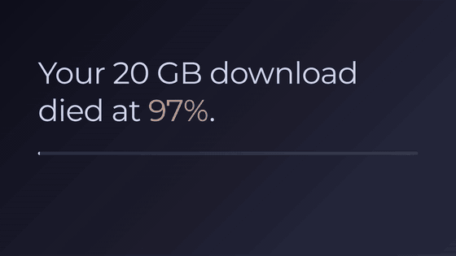

<div align="center">

<picture>
  <source media="(prefers-color-scheme: dark)" srcset="https://raw.githubusercontent.com/whoisjayd/blazeserve/main/docs/assets/logo-mark.svg" />
  
</picture>

# BlazeServe

**A file server for large files.**<br />
Share a folder or a single file in one command, and pick up interrupted downloads and uploads where they stopped.

[](https://github.com/whoisjayd/blazeserve/actions/workflows/ci.yml)
[](https://github.com/whoisjayd/blazeserve/releases)
[](https://pypi.org/project/blazeserve/)
[](LICENSE)

<a href="#quick-start">Quick start</a> · <a href="#common-jobs">Common jobs</a> · <a href="#documentation">Documentation</a> · <a href="#security">Security</a> · <a href="#contributing">Contributing</a>

<br />



[Watch the full video](https://github.com/whoisjayd/blazeserve/blob/main/docs/assets/demo.mp4) (88 seconds, MP4)

</div>

<br />

BlazeServe is one program for Linux, Windows and macOS, with nothing else to install. Use it to hand a file to a colleague, or put it behind a proxy to host build artifacts, datasets or a download mirror. Memory use stays small however large the file is.

- Downloads and uploads resume where they stopped, and a download can use several connections to go faster.
- Visitors cannot leave the folder you share, and uploads stay off until you turn them on.
- A missing password setting stops the server instead of leaving it open.
- HTTPS, HTTP/2, speed limits, health checks, Prometheus metrics and JSON logs are built in.
- The Python package starts a server inside a script or a test, and BlazeServe is also a Rust library.

## Quick start

```bash
pip install blazeserve
blaze serve .
```

Open `http://localhost:8000` to browse the folder, with search and sorting. Press `Ctrl+C` to stop.

<details>
<summary>Other ways to install</summary>

<br />

| Method | Command |
| :--- | :--- |
| uv | `uv tool install blazeserve` |
| Cargo | `cargo install --git https://github.com/whoisjayd/blazeserve` |
| Docker | `docker run --rm -p 8000:8000 -v "$PWD":/data:ro ghcr.io/whoisjayd/blazeserve:latest` |
| Download | An archive from the [Releases page](https://github.com/whoisjayd/blazeserve/releases), checked against `SHA256SUMS` |

Builds exist for Linux (x86_64 and aarch64), Windows x86_64 and macOS (Intel and Apple silicon). Building from source needs Rust 1.88 or newer.

</details>

## Common jobs

| To | Run |
| :--- | :--- |
| Share a folder | `blaze serve ./site` |
| Share one file | `blaze send ./big.iso` |
| Open a shared file on a phone | `blaze send ./big.iso --qr` |
| Download, resuming if the connection drops | `blaze get http://host:8000/big.iso` |
| Download faster over eight connections | `blaze get http://host:8000/big.iso -c 8` |
| Upload with resume | `blaze put ./big.iso http://host:8000/` |
| Allow only this computer | `blaze serve ./site --host 127.0.0.1` |
| Limit each visitor to 25 MB/s | `blaze serve . --rate-mbps 25` |
| Keep sensitive files out of sight | `blaze serve . --hide '*.env' --hide .git` |
| Accept uploads, with a password | `blaze serve ./incoming --max-upload-mb 500 --auth-env BLAZE_AUTH` |
| Get a file's SHA-256 | `blaze checksum ./big.iso` |
| Check that setup is healthy | `blaze doctor ./site` |

Keep passwords out of your shell history by putting them in an environment variable:

```bash
export BLAZE_AUTH='alice:s3cret'          # PowerShell: $env:BLAZE_AUTH = "alice:s3cret"
blaze serve ./site --auth-env BLAZE_AUTH
```

If the variable is missing or empty, BlazeServe refuses to start. It never quietly runs without a password.

## Documentation

| Learn | Run it | Look up |
| :--- | :--- | :--- |
| [Getting started](https://github.com/whoisjayd/blazeserve/blob/main/docs/getting-started.md) | [Deployment](https://github.com/whoisjayd/blazeserve/blob/main/deploy/README.md) | [Reference](https://github.com/whoisjayd/blazeserve/blob/main/docs/reference.md) |
| [Sharing and downloading](https://github.com/whoisjayd/blazeserve/blob/main/docs/sharing-files.md) | [Monitoring](https://github.com/whoisjayd/blazeserve/blob/main/docs/monitoring.md) | [Troubleshooting](https://github.com/whoisjayd/blazeserve/blob/main/docs/troubleshooting.md) |
| [Serving files](https://github.com/whoisjayd/blazeserve/blob/main/docs/serving-files.md) | [Security](https://github.com/whoisjayd/blazeserve/blob/main/docs/security.md) | [Python and Rust](https://github.com/whoisjayd/blazeserve/blob/main/docs/python-and-rust.md) |
| [Uploads](https://github.com/whoisjayd/blazeserve/blob/main/docs/uploads.md) | [Performance](https://github.com/whoisjayd/blazeserve/blob/main/docs/performance.md) | [Telemetry](https://github.com/whoisjayd/blazeserve/blob/main/docs/telemetry.md) and [upgrading from 0.x](https://github.com/whoisjayd/blazeserve/blob/main/docs/upgrading.md) |

## Security

BlazeServe assumes visitors may be hostile. It keeps every request inside the folder you share, compares passwords in constant time, requires TLS 1.2 or newer, limits connections and slow clients, and never writes passwords or file contents to its logs. The [security guide](https://github.com/whoisjayd/blazeserve/blob/main/docs/security.md) explains this and lists what it cannot protect against.

To report a vulnerability, follow [SECURITY.md](SECURITY.md) and please do not open a public issue.

## Usage statistics

BlazeServe sends a small anonymous usage report when `serve` or `send` starts and stops. It contains the version, the operating system, which features are on (yes or no only) and rough usage ranges. It never contains file names, addresses, passwords or anything from a request, and there is no install ID.

Turn it off with `BLAZE_TELEMETRY=0`, `DO_NOT_TRACK=1` or `blaze telemetry disable`. It is also off whenever `CI` is set. Run `blaze telemetry preview` to see exactly what would be sent, or read the [telemetry guide](https://github.com/whoisjayd/blazeserve/blob/main/docs/telemetry.md).

## Upgrading from 0.x

Version 1.0 is a rewrite in Rust. Most things work as before, but the Python API was removed, and uploads are now off unless you set a size limit and a password. The [upgrade guide](https://github.com/whoisjayd/blazeserve/blob/main/docs/upgrading.md) lists every change.

## Contributing

Bug reports, fixes and documentation improvements are welcome. Read [CONTRIBUTING.md](CONTRIBUTING.md) first, and [open an issue](https://github.com/whoisjayd/blazeserve/issues/new/choose) if you found a bug.

```bash
git clone https://github.com/whoisjayd/blazeserve
cd blazeserve
cargo test
cargo run -- serve .
```

## License

BlazeServe is released under the [MIT license](LICENSE).
